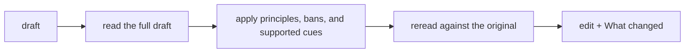

# Anti-Slop

Edits drafts into clear, natural prose and reports the changes.

## What It Does



| Phase | Output |
|-------|--------|
| Edit | The edited draft, with prose changed only and code, data, frontmatter, link targets, and identifiers kept |
| Report | What changed: one line per pattern or principle with the original and new wording, a count for mechanical changes, and any open item |

## Usage

```text
Clean up this draft, keep it sounding like me
Make this post less AI-sounding
Remove the AI-writing patterns from docs/notes/launch.md
```

## FAQ

**Q: Does it work in languages other than English?** A: Yes. It writes in the draft's language. The word lists are English, but the skill matches the same patterns in other languages.

**Q: Does it tell me whether AI wrote the piece?** A: No. It edits the patterns and reports the changes. It does not identify the author.

**Q: Will it flatten my voice?** A: The edit keeps distinctive words, rhythm, bluntness, humor, and digressions, except where they match a ban. A writing sample you supply overrides the bans.

**Q: Does it add opinions or personality?** A: Not by default. Technical, reference, legal, and factual prose stays neutral and precise. Personal and editorial prose can keep personality when the source supports it.

**Q: Does it change every word on its lists?** A: No. Bans, such as a dash used as an aside, change except in quotations, proper names, code, the grammar of the draft's language, and a supplied writing sample. Cues, such as a listed word, change only when the context supports it.
