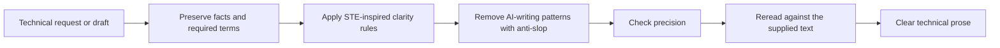

# Plain Spoken

Makes technical prose easier to understand without removing necessary precision.

## What It Does



| Phase | Output |
| ----- | ------ |
| Write | The text in clear language, with requirements, code, identifiers, and domain terms kept accurate |
| Report | When the request supplied text, What changed: one line per principle or pattern with the original and new wording, a count for mechanical changes, and any open item |

## Usage

```text
explain this architecture in plain technical English
rewrite this runbook with less jargon
write a how-to guide for rotating the signing key
make this API error explanation easier for a global team to understand
use an ASD-STE100 style for this maintenance procedure
simplify this technical note and show what changed
```

## Requirements

The `anti-slop` skill is optional. When it is installed, the skill runs it over each draft; when it is absent, the skill skips that pass.

Formal ASD-STE100 conformance requires the official standard and the approved terminology for the applicable company, industry, or subject field. Without both sources, the skill labels the result as best effort rather than compliant.

## FAQ

**Q: Does the agent use it without being asked?** A: Yes. The agent can select it automatically for technical prose written for people, including brief factual answers, explanations, runbooks, specifications, incident reports, architecture notes, procedures, and documentation. One-word confirmations, code-only output, and raw logs remain unchanged.

**Q: What does it return?** A: The text in clear language. When the request supplied text, a What changed report follows it, one line per principle or pattern.

**Q: Does it follow ASD-STE100?** A: It adapts principles from [ASD-STE100 Simplified Technical English](https://www.asd-ste100.org/) to agent responses. It does not reproduce the controlled dictionary or claim formal compliance.

**Q: Does it remove every technical term?** A: No. It keeps terms that carry necessary meaning and defines unfamiliar terms when the reader needs the definition.

**Q: Does it work for Portuguese output?** A: Yes. The structural rules and the word-choice test apply the same way in any language. The controlled dictionary is English; in another language, apply the same test to the equivalent word pair. Only English text can be called Simplified Technical English, because formal conformance is defined for English.

**Q: Does simple mean childish?** A: No. The target is direct, precise language for readers with different levels of proficiency in the language of the text.
