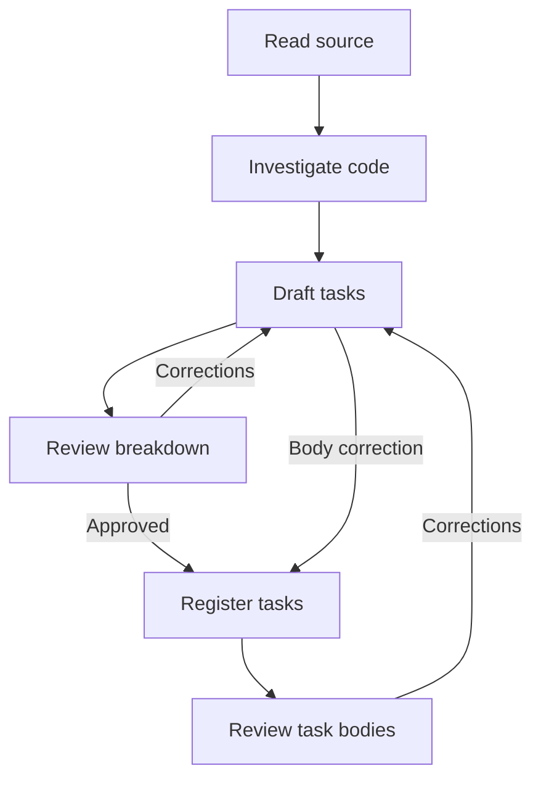

# To Tasks

Break the work in the conversation or in supplied material into tasks an agent can implement.

## What It Does



| Phase | Output |
|-------|--------|
| Source | Behavior, criteria, decisions, and exclusions to break down, plus existing sub-issues of a parent issue |
| Investigation | Prefactor candidates, wide mechanical changes, and answered open questions |
| Breakdown | Tasks cut as vertical slices that together cover the source, each with its blocking issues |
| Breakdown review | User-approved titles, one-line summaries, and blocking issues |
| Registration | One issue per task with its blocking issues, attached as a sub-issue when an issue was supplied |
| Body review | User-approved task bodies in their tracker issues |

## Usage

```text
/to-tasks break this spec issue into tasks
/to-tasks split the plan we agreed on into tasks an agent can pick up
/to-tasks register a single task for adding CSV export to the reports page
```

## Output

One tracker issue per task with the `task` label and its blocking issues, as a sub-issue of the parent issue when there is one.

## Requirements

A connected tracker tool or authenticated CLI.
