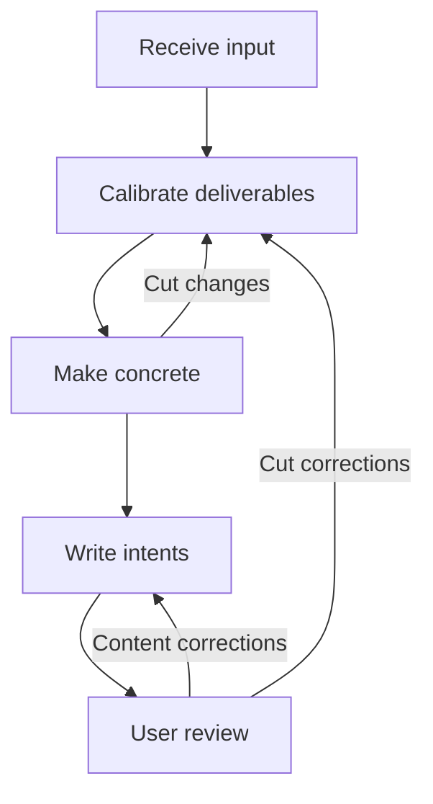

# Write Intents

Turn an input into concrete intents with the user.

## What It Does



| Phase | Output |
|-------|--------|
| Receive | Input understood |
| Calibrate | One intent per deliverable |
| Make concrete | Template fields filled per intent; unknowns kept explicit |
| Write | Intent files, each with a stable ID |
| Review | Intent files corrected with the user |

## Usage

```text
/write-intents Customers call to ask for claim status; let them check it in the portal using their existing login.
/write-intents Turn this incident into an intent and keep unknowns as open questions.
/write-intents Cut this PRD into deliverables, one intent each, for review.
```

## Output

One `docs/intents/<id>-<slug>.md` per intent, for example `docs/intents/003-claim-status-portal.md`. The three-digit `id` grows with each new intent, and is never reused or renumbered.
