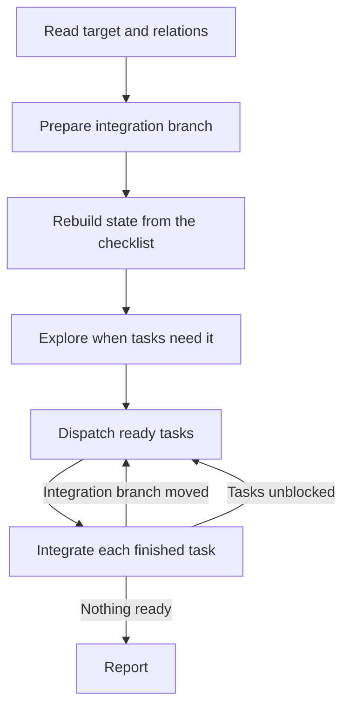

# Implement

Implement a spec, one of its tasks, or a standalone task, building each task test-first in a fresh sub-agent and integrating the results on one branch.

## What It Does



| Phase | Output |
|-------|--------|
| Target | Spec and tasks with their native blocking links |
| Branch | One integration branch per spec, reused across runs |
| State | Each task integrated, resumed, or pending, with integration tracked in `.artifacts/implement/[spec-id]/checklist.md` |
| Exploration | Shared notes in `.artifacts/implement/[spec-id]/`, when the tasks need them |
| Dispatch | One fresh implementer per ready task, in its own worktree, with the task set to in progress |
| Integration | Integration branch fast-forwarded to each verified task, with the checklist line ticked, the task set to done, and the task branch deleted |
| Report | Tasks with commits and verification, blockers, and tasks not started |

## Usage

```text
/implement spec implement every task of this spec issue
/implement task implement this task of the spec
/implement task implement this standalone task that has no spec
```

## Output

Local commits on the integration branch `[spec-id]-[slug]`, one branch per task until it is integrated, tracker statuses set to in progress on dispatch and done on integration, and the checklist and exploration notes in `.artifacts/implement/[spec-id]/`. Nothing is pushed, and the main checkout is never switched.

## Requirements

A connected tracker tool or authenticated CLI with sub-issues and blocking links, git with worktree support, and sub-agents.
