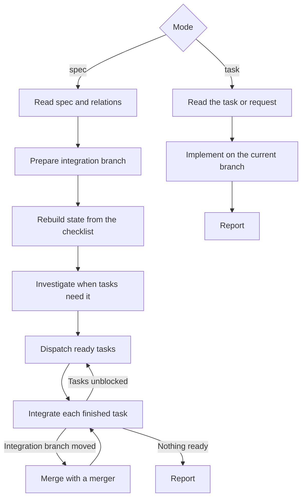

# Implement

Implement a spec with each task in a fresh sub-agent integrated on one branch, or one task or request directly on the current branch.

## What It Does



| Mode | Output |
|------|--------|
| Spec | One integration branch per spec, reused across runs; one fresh implementer per ready task in its own worktree; the integration branch fast-forwarded to each finished task, with a lighter merger bringing a task up to a moved integration branch; integration tracked in `.artifacts/implement/[issue-id]/checklist.md` with investigation notes beside it; a report of tasks with commits and verification, blockers, and tasks not started |
| Task | Commits on the current branch for one task of a spec, a standalone task, or a free-form request, with a task issue left in progress for its pull request to close, and a report of commits, verification, and blockers |

## Usage

```text
/implement spec implement every task of this spec issue
/implement task implement this task of the spec
/implement task implement this standalone task that has no spec
/implement task add a retry to the failed upload request
```

## Output

In `spec` mode: local commits on the integration branch `[issue-id]-[slug]`, one branch per task until it is integrated, each task set to in progress on dispatch and to done on integration, the spec set to in progress with its first task, and the checklist and investigation notes in `.artifacts/implement/[issue-id]/`; the main checkout is never switched. In `task` mode: local commits on the current branch, with a task issue set to in progress. Nothing is pushed.

## Requirements

Git. For `spec` mode, a connected tracker tool or authenticated CLI with sub-issues and blocking links, git worktree support, and sub-agents. For `task` mode with an issue, a connected tracker tool or authenticated CLI.
