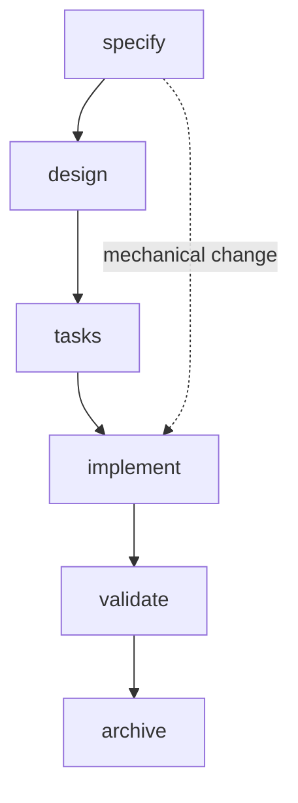

# Spec-Driven Development

Feature development in phases, light by default and weighty only where the change pays for it.

## Triggers

- **Specify** — plan a feature or turn an input into a spec ("plan feature", "spec this", "from PRD", "modify feature") → [specify.md](references/specify.md) · the feature spec and its triage
- **Design** — the technical design ("design this feature", "technical design", "plan the build") → [design.md](references/design.md) · the design document
- **Tasks** — break the design into tasks ("create tasks", "task breakdown") → [tasks.md](references/tasks.md) · the task list with its ordering
- **Implement** — execute tasks or slices ("implement task T-1", "implement slice S-1", "implement everything") → [implement.md](references/implement.md) · the implemented and verified change
- **Validate** — user acceptance testing ("run UAT", "manual testing", "validate flows") → [validate.md](references/validate.md) · the UAT result
- **Archive** — archive a finished feature ("archive feature", "archive this spec") → [archive.md](references/archive.md) · the archived spec

## Workflow

Specify's triage decides the path: a mechanical change with zero load-bearing decisions becomes a one-liner straight to inline implement on its own branch, and a prompt carrying outcomes that ship separately becomes one feature per outcome. Everything else produces the artifacts and runs the phases in turn. Verify is mental, per task, inside implement — never a user phase. Validate is optional UAT on the running application. Archive is manual housekeeping for a feature in any state, never automatic or suggested.
