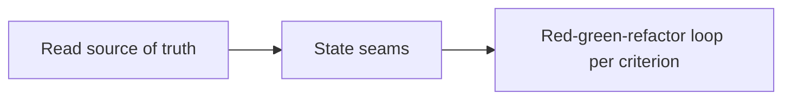

# Test Driven

Build a change test-first, with tests anchored to the source of truth at confirmed seams.

## What It Does



| Phase | Output |
|-------|--------|
| Source | Acceptance criteria |
| Seams | One line per seam: what it catches and what it misses, confirmed by the user or taken from the spec |
| Loop | One failing test, the minimum code to pass, then a refactor with the tests green, per criterion |

## Usage

```text
implement this issue test-first
fix this bug starting with a test that reproduces it
build this slice with red-green against the spec
```
