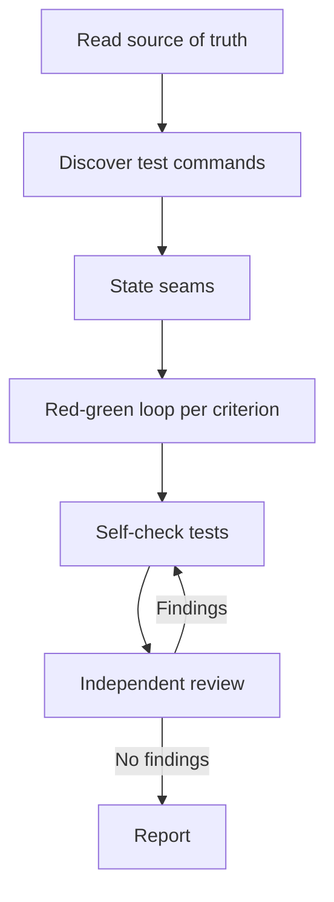

# Test Driven

Build a change test-first, with tests anchored to the source of truth and reviewed by a fresh reviewer.

## What It Does



| Phase | Output |
|-------|--------|
| Source | Concrete expected value per acceptance criterion, plus recorded gaps |
| Discovery | Focused-test and full-suite commands |
| Seams | One line per seam: what it catches and what it misses |
| Loop | One failing test, then the minimum code to pass, per criterion |
| Self-check | Tests checked against the quality checks and anti-patterns |
| Review | Findings from a fresh reviewer, fixed and checked again |
| Report | Criteria mapped to tests, gaps, contradictions, and test results |

## Usage

```text
implement this issue test-first
fix this bug starting with a test that reproduces it
build this slice with red-green against the spec
```
