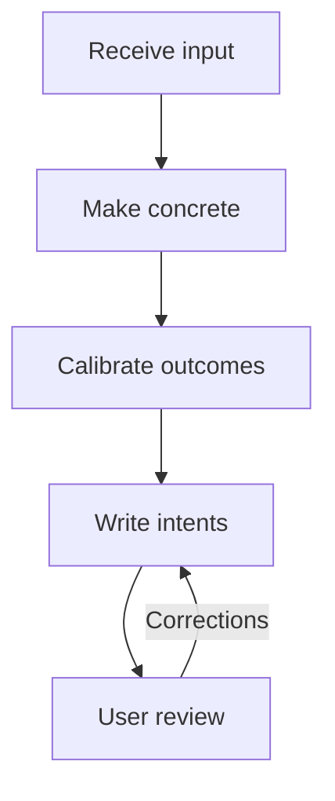

# To Intent

Turn an input into concrete intents with the user.

## What It Does



| Phase | Output |
|-------|--------|
| Receive | Input and claims to check |
| Make concrete | Template fields filled; unknowns kept explicit |
| Calibrate | One intent per independent outcome |
| Write | Intent files with problem, outcome, affected users and systems, constraints, and open questions |
| Review | User-approved intent files |

## Usage

```text
/to-intent Customers call to ask for claim status; let them check it in the portal using their existing login.
Turn this incident into an intent and keep unknowns as open questions.
Capture the independent outcomes in this document as intents for review.
```

## Output

One `docs/intents/<slug>.md` per intent.
