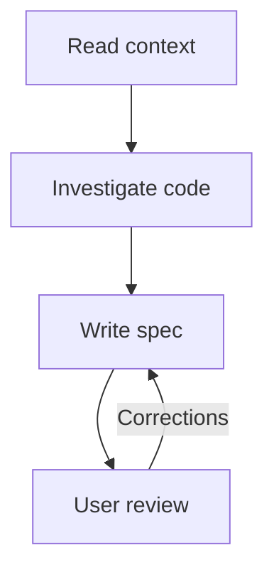

# To Spec

Turn agreed context into a specification of behavior, technical decisions, and tests.

## What It Does



| Phase | Output |
|-------|--------|
| Context | Intended outcome, constraints, and explicit uncertainties |
| Investigation | Grounded implementation and testing decisions |
| Specification | Local, unversioned spec with problem, solution, user stories, decisions, exclusions, and notes |
| Review | User-approved spec |

## Usage

```text
/to-spec turn this conversation into a specification
/to-spec specify the agreed change from the supplied materials
/to-spec update the existing specification with these revised decisions
```

## Output

`.artifacts/work/<slug>/spec.md`. The file remains available for later use; the skill does not remove it.
