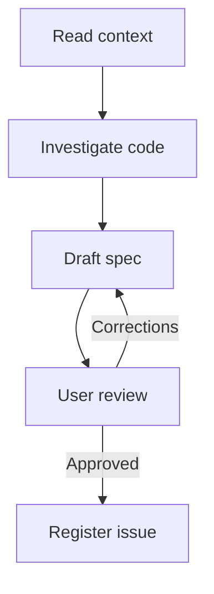

# To Spec

Turn agreed context into a specification of behavior, technical decisions, and tests.

## What It Does



| Phase | Output |
|-------|--------|
| Context | Intended outcome, constraints, and explicit uncertainties |
| Investigation | Grounded implementation and testing decisions |
| Specification | Draft spec with problem, solution, user stories, decisions, exclusions, and notes |
| Review | User-approved spec text |
| Registration | One tracker issue holding the approved spec |

## Usage

```text
/to-spec turn this conversation into a specification
/to-spec specify the agreed change from the supplied materials
/to-spec update the existing specification with these revised decisions
```

## Output

One tracker issue per spec. Drafts stay in the conversation; no local spec file is written.

## Requirements

A connected tracker tool or authenticated CLI is required for registration. Without tracker access, the skill returns the approved spec and reports the blocker.
