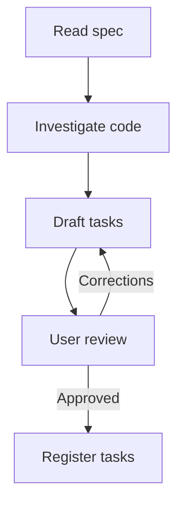

# To Tasks

Break an approved spec into tasks an agent can implement.

## What It Does



| Phase | Output |
|-------|--------|
| Spec | Stories, criteria, decisions, and exclusions to break down, plus existing sub-issues |
| Investigation | Prefactor candidates and wide mechanical changes |
| Breakdown | Tasks cut as vertical slices that together cover the spec, with blocking edges |
| Review | User-approved breakdown |
| Registration | One sub-issue per task, with native parent and blocking links |

## Usage

```text
/to-tasks break this spec issue into tasks
/to-tasks split the approved spec into tasks an agent can pick up
```

## Output

One tracker sub-issue per task under the spec issue. Blocking edges are native tracker links. No local file is written.

## Requirements

A connected tracker tool or authenticated CLI that supports sub-issues and blocking links. Without tracker access, the skill returns the approved tasks and reports the blocker.
