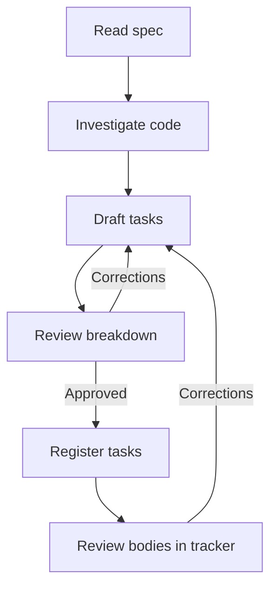

# To Tasks

Break an approved spec into tasks an agent can implement, or register one task that belongs to no spec.

## What It Does



| Phase | Output |
|-------|--------|
| Spec | Stories, criteria, decisions, and exclusions to break down, plus existing sub-issues |
| Investigation | Prefactor candidates and wide mechanical changes |
| Breakdown | Tasks cut as vertical slices that together cover the spec, with blocking edges |
| Breakdown review | User-approved titles, one-line summaries, and blocking edges |
| Registration | One sub-issue per task, with native parent and blocking links; a standalone task is created with no parent |
| Body review | User-approved task bodies in their tracker issues |

## Usage

```text
/to-tasks break this spec issue into tasks
/to-tasks split the approved spec into tasks an agent can pick up
/to-tasks standalone add SwiftFormat to the project, with no spec
```

## Output

One tracker sub-issue per task under the spec issue, or one issue with no parent in standalone mode. Blocking edges are native tracker links. Without a configured tracker or tracker access, one numbered markdown file per task in a project directory the user confirms, or the conversation when the user declines the files.

## Requirements

A connected tracker tool or authenticated CLI that supports sub-issues and blocking links. Without a configured tracker or tracker access, the skill reports the blocker and offers the markdown files.
