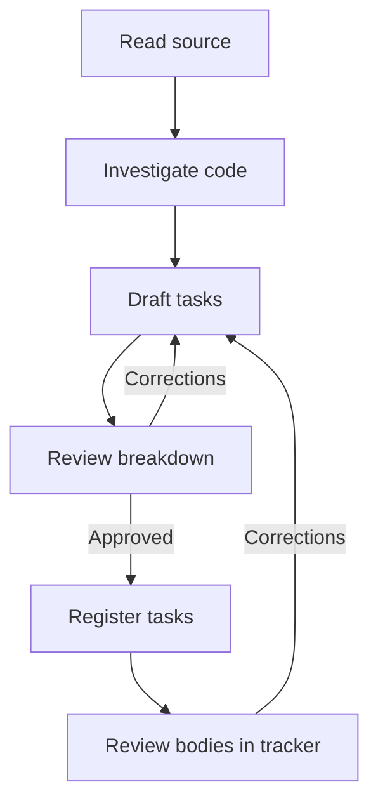

# To Tasks

Break a spec, a plan, or the conversation into tasks an agent can implement.

## What It Does



| Phase | Output |
|-------|--------|
| Source | Behavior, criteria, decisions, and exclusions to break down, plus existing sub-issues of a source issue |
| Investigation | Prefactor candidates, wide mechanical changes, and answered open questions |
| Breakdown | Tasks cut as vertical slices that together cover the source, with blocking edges |
| Breakdown review | User-approved titles, one-line summaries, and blocking edges |
| Registration | One issue per task with native blocking links, attached as a sub-issue when an issue was supplied |
| Body review | User-approved task bodies in their tracker issues |

## Usage

```text
/to-tasks break this spec issue into tasks
/to-tasks split the plan we agreed on into tasks an agent can pick up
/to-tasks register a task to add functionality to the project
```

## Output

One tracker issue per task, as a sub-issue of the source issue when there is one. Blocking edges are native tracker links. Without tracker access, the tasks in the conversation.

## Requirements

A connected tracker tool or authenticated CLI. When the tracker lacks native sub-issues or blocking links, the skill reports the limitation and asks before writing. Without tracker access, the skill reports the blocker and shows the tasks in the conversation.
