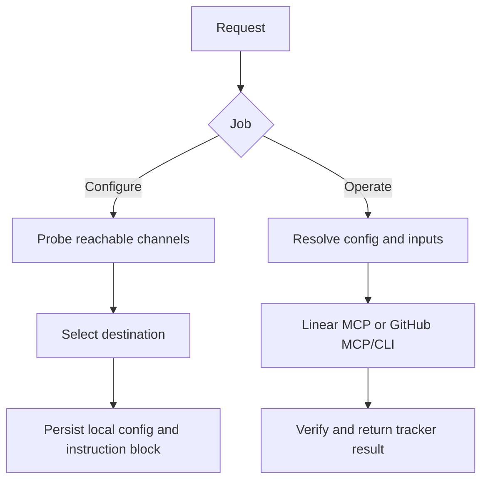

# Tracker Config

Configure the project's tracker and perform issue operations through a shared destination.

## What It Does



| Operation | Output |
|-----------|--------|
| Configure | Reachable tracker, validated destination, local settings, and one Issue tracker instruction block |
| Operate | Verified issue reads/writes, status, hierarchy, dependencies, milestones, and metadata; explicit partial or unsupported results |

## Usage

```text
Configure Linear for this repository using the ENG team and Platform project.
Switch this repository to GitHub Issues and use gh as the primary channel.
Inspect the current tracker configuration without changing it.
Create an issue using this approved title and body in the configured tracker.
List the open issues in the configured project.
Set these issues as blockers of this issue.
```

## Output

Repository-local Git settings use `tracker.*`. The repository instruction file carries one `## Issue tracker` section. Issues and relations live in the tracker; no local issue-body copies are written. Configuration inputs may use a temporary JSON file outside the repository.

## Requirements

Git and Python 3 for the bundled configuration script. Linear requires a connected MCP with the requested capabilities. GitHub requires a connected MCP or installed, authenticated gh CLI. Missing capabilities are reported; no tracker is required merely to inspect stored settings.

## FAQ

**Q: Does configuring a tracker move existing issues?** A: No. Reconfiguration changes the destination for future operations.

**Q: Does this write issue descriptions for me?** A: No. Writes take the supplied title and body; the skill configures the integration and performs the requested operation.

**Q: What happens after a timeout during creation?** A: The skill reconciles remote state before retrying or using the fallback. It reports an unknown outcome when it cannot confirm what happened.
