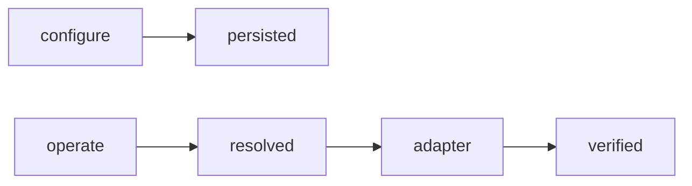

# Tracker Config

Configure the project's issue tracker and run its operations.

## Triggers

- **Configure** — set up, inspect, repair, or change the tracker → [configure.md](references/configure.md) · the configuration files and the resolved destination
- **Operate** — read or write issues, status, hierarchy, dependencies, milestones, or metadata → [operate.md](references/operate.md) · the tracker operation and its result

## Workflow

