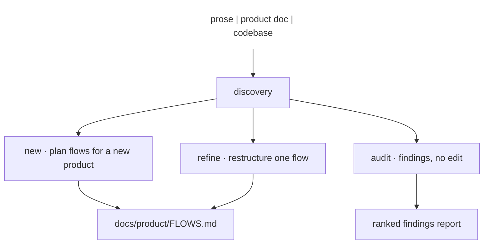

# App Flow

Plan, audit, and refine the user flows of a website, a mobile app, or any other product surface — one flow per task, kept in a committed artifact.

## What It Does



| Mode | Output |
|------|--------|
| New | `docs/product/FLOWS.md` — one wireflow per task, dead-end register, connect map, priority order |
| Audit | Ranked findings in chat: dead ends, merged flows, broken hand-offs — no file edited |
| Refine | The named flow rewritten and written back, with before/after wireflows and a screen count |

Every flow keeps one diagram, one task. Connections between flows are named hand-offs, never a merged mega-map.

## Usage

```text
Plan the app flows for this delivery app
Map the flows for this checkout — here is the PRD
Audit the flows of this app and tell me where the dead ends are
Shorten the signup flow
Restructure the onboarding — it covers both signup and tour, split it
```

## Output

`docs/product/FLOWS.md`, committed — product name, priority flows, one section per flow (goal, entry, wireflow, dead ends, connections), the connect map, and what discovery left unset.

## FAQ

**Q: Is this a wireframe or mockup tool?** A: No — the output is flow structure (screens as nodes, actions as arrows). Visual design is a different skill's job.
