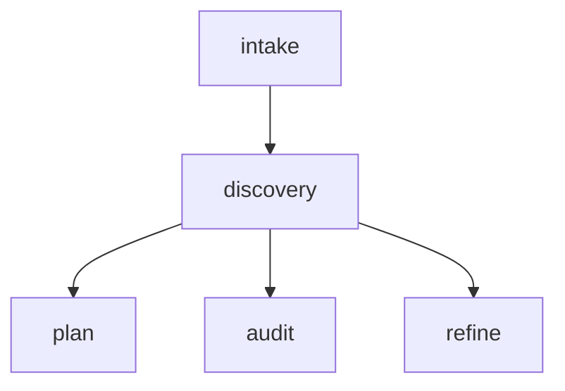

# App Flow

Plans the user paths of a website, a mobile app, or any other product surface as named flows — one flow per task — and keeps them in a committed artifact.

## Triggers

- **Plan new app flows** ("plan the app flow", "map the flows", "design the flow for this checkout", "what flows does this app need") → [plan.md](references/plan.md) · intake, the flow list, the per-flow draft, the connect map, and the artifact
- **Audit** ("audit the flows", "check my app's flows", "find the dead ends") → [audit.md](references/audit.md) · the rubric and the ranked finding format
- **Refine** ("improve this flow", "shorten the signup flow", "restructure the onboarding", "update this flow from the review comments") → [refine.md](references/refine.md) · locate the flow, judge it, write it back

Each entry is independent. Every entry states its read of the situation before flow work and lets the user redirect.
