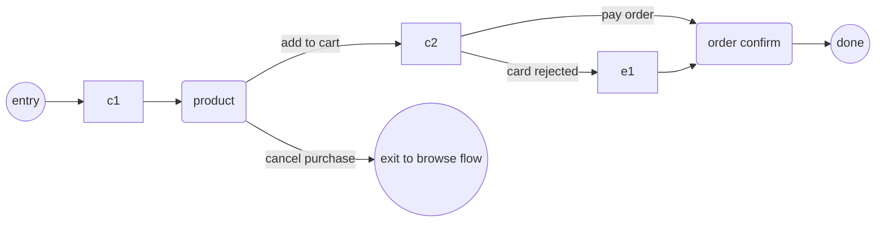

# Flow Model

Vocabulary, wireflow notation, and structure rules for app flows. Loaded before flows are drafted, audited, or rewritten.

## When to Use

To name flows, draw or read wireflow diagrams, and judge whether a flow is well formed.

## Vocabulary

| Term | Meaning |
|------|---------|
| Flow | The complete path for one task: trigger → screens → exits. One flow per task, never merged. |
| Happy path | The path with no error and no detour. Mapping starts here; branching comes after. |
| Step | One step = one screen. An action ("pay") is not a step. |
| Exit | Success screen or a return into a known screen. |
| Dead end | A screen or state whose only outcome is none of the above. |
| Connection | A named point where one flow hooks into another: the terminal node that hands off, and which flow receives it. |

### Flow types

| Type | Covers | Typical shape |
|------|--------|---------------|
| Onboarding/auth | signup, login, recover | Branchy — error and recovery states dominate |
| Task | book, create, upload, configure | Linear with a few grows |
| Conversion | browse → cart → pay → confirm | Linear; the shorter the better |
| Settings | profile, preferences | Shallow — edit and save usually one screen |

Do not build one mega-map across types. The strong app-flow is several named flows plus a connect map showing where they hand into each other — never a single diagram that absorbs the whole app.

## Wireflow notation

Use mermaid `flowchart` (or plain box-and-arrow ASCII) per flow. Keep one shape family:

- Rounded/named node = screen; double circle = entry or app exit; diamond `{question?}` = a condition the system checks, never a screen or a step; hexagon `{{link created}}` = a domain state change, never a screen or a step
- Label an arrow only where the screen has more than one exit or the system decides the outcome; leave a single-exit arrow unlabeled
- Label an arrow with the user's action as a short verb + object: "pay order", "accept terms"
- Label a system outcome the user does not choose as the resulting state: "card rejected", "first visit"
- Draw a condition that one path reaches as the label of its arrows; draw a condition that more than one path reaches as one diamond, merge those paths into it, and label each of its exits with one answer
- Place a state-change hexagon on the arrow where the flow text says the change happens, never in the exit circle; the exit names the hand-off or the end, not a domain state
- One label, one outcome: never "X or not X"; draw each outcome as its own arrow
- Keep timeouts and business rules out of labels; record a timeout in the flow's dead-end register and a business rule in the flow's rules field
- One flow, one diagram — never combined, never split across two files

## Structure rules

1. Happy path first — branch after it exists; otherwise error paths swallow the main path. In the diagram source, declare the happy path first as one sequence, then alternate paths, then errors and returns.
2. One entry — either the trigger that starts the flow (notification, deep link) or the entry carried by the connect map.
3. Every screen exits to success or to a known screen — no unrecovered dead end.
4. Flows connect through named hand-offs — the terminal node of one names the flow that receives it (signup → onboarding, browse → product). A flow that ends elsewhere with no named receiver is a gap, not a shortcut.
5. Detail by priority — the 1–2 flows of highest value get full branch coverage; the rest get drafted happy-path only, and stay consistent with the same rules.
6. Fix readability in the source — when a rendered diagram reads poorly, drop labels the notation does not require, merge repeated conditions into a diamond, and reorder declarations; never rely on placing labels by hand.

## Well-formed flow

A draft is done when it has: a name, a goal ("complete checkout from the product screen"), an entry, wireflow labeled per the notation rules, dead ends enumerated across the register's categories (error, cancel, timeout, empty state, denied — each with its exit, or marked `n/a`), the business rules the flow enforces (or none), and the connections it starts from or hands to. Every step counts as exactly one screen.
