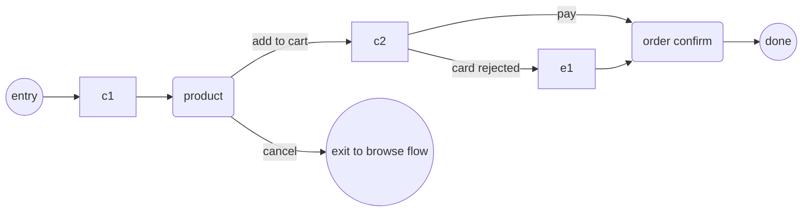

# Flow Model

Vocabulary, wireflow notation, and structure rules for app flows. Loaded before flows are drafted, audited, or rewritten.

## When to Use

To name flows, draw or read wireflow diagrams, and judge whether a flow is well formed.

## Vocabulary

| Term | Meaning |
|------|---------|
| Flow | The complete path for one task: trigger → screens → exits. One flow per task, never merged. |
| Happy path | The path with no error and no detour. Mapping starts here; branching comes after. |
| Step | One step = one screen. An action ("pay") is not a step. |
| Exit | Success screen or a return into a known screen. |
| Dead end | A screen or state whose only outcome is none of the above. |
| Connection | A named point where one flow hooks into another: the terminal state that hands off, and which flow receives it. |

### Flow types

| Type | Covers | Typical shape |
|------|--------|---------------|
| Onboarding/auth | signup, login, recover | Branchy — error and recovery states dominate |
| Task | book, create, upload, configure | Linear with a few grows |
| Conversion | browse → cart → pay → confirm | Linear; the shorter the better |
| Settings | profile, preferences | Shallow — edit and save usually one screen |

Do not build one mega-map across types. The strong app-flow is several named flows plus a connect map showing where they hand into each other — never a single diagram that absorbs the whole app.

## Wireflow notation

Use mermaid `flowchart` (or plain box-and-arrow ASCII) per flow. Keep one shape family:

- Rounded/named node = screen; double circle = entry or app exit
- Label every arrow with the action that takes the user across
- Draw state ("card rejected", "first visit") inside the arrow label, not as a hidden screen
- One flow, one diagram — never combined, never split across two files

## Structure rules

1. Happy path first — branch after it exists; otherwise error paths swallow the main path.
2. One entry — either the trigger that starts the flow (notification, deep link) or the entry carried by the connect map.
3. Every screen exits to success or to a known screen — no unrecovered dead end.
4. Flows connect through named hand-offs — the terminal state of one names the flow that receives it (signup → onboarding, browse → product). A flow that ends elsewhere with no named receiver is a gap, not a shortcut.
5. Detail by priority — the 1–2 flows of highest value get full branch coverage; the rest get drafted happy-path only, and stay consistent with the same rules.

## Well-formed flow

A draft is done when it has: a name, a goal ("complete checkout from the product screen"), an entry, wireflow with labeled arrows, dead ends enumerated across the register's categories (error, cancel, timeout, empty state, denied — each with its exit, or marked `n/a`), and the connections it starts from or hands to. Every step counts as exactly one screen.
