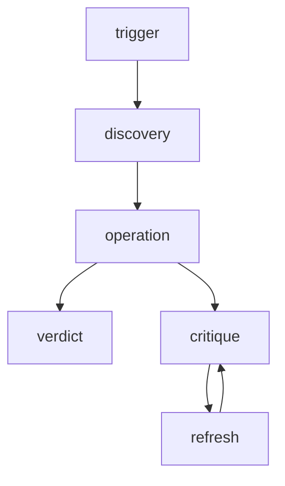

# Copywriting

Own `copy.yaml`, the structured content payload that design consumes. The same payload must work with any visual identity, so this skill carries words, not design decisions.

## Triggers

**Author** — produce or change copy:

- **Write** ("write the headline", "new copy from this brief", "we need a value proposition") → [write.md](references/write.md) · new copy from intent and source material
- **Extract** ("structure this page", "pull the copy from this URL", "turn this brief into copy.yaml") → [extract.md](references/extract.md) · a source structured into `copy.yaml`
- **Refresh** ("tighten this", "the copy reads weak", "polish before handoff") → [refresh.md](references/refresh.md) · the copy tightened in the same voice
- **Revoice** ("make it playful", "make it sound premium", "drier, less salesy") → [revoice.md](references/revoice.md) · the voice changed
- **Reconcile** ("sync copy from code", "the implementation drifted") → [reconcile.md](references/reconcile.md) · drifted values synced from code

**Judge** — a non-mutating verdict on existing copy:

- **Critique** ("does this read as slop", "score the copy", "verdict before more editing") → [critique.md](references/critique.md) · the slop verdict and its score
- **Audit** ("is this copy ready to ship", "defect report before handoff") → [audit.md](references/audit.md) · the defect report for handoff

Classify the request by what it wants done to the copy, and infer from source and intent rather than asking. "Before handoff" matches two operations: a judging request with no implementation source is **audit**, while a sync request naming code or a live URL as the source of truth is **reconcile**.

## Workflow

Every operation starts by loading discovery. A judging verdict is applied by running the matching authoring operation, never by patching from the judgment itself.
