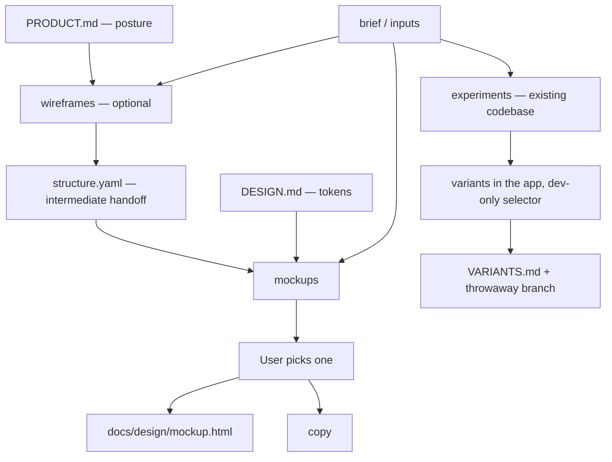

# Craft UI

Decide how the interface is arranged, then how it looks, by building both.

## What It Does



| Phase | Output |
|-------|--------|
| wireframes | Optional interview and N lo-fi arrangements per surface, judged with no palette, font pick, or tokens; the chosen arrangement becomes the intermediate `structure.yaml` handoff |
| mockups | N directions rendered from `structure.yaml` when present, or with an arrangement chosen per direction when absent, using brief inputs and neutral placeholders since final copy comes after the mockup; the chosen one lands in `docs/design/` |
| experiments | On a project with UI, N variants of a page or section built as sibling components inside the running app and switched by a dev-only `?variant=` selector; the choice and its reason are recorded in `VARIANTS.md`, and the code stays on a throwaway branch |

## Usage

```text
plan the layout for these screens
map the screen flow and stop at the plan
generate 4 mockup directions from the structure.yaml
generate mockups in an editorial direction
render a mockup of this page before there is a DESIGN.md
make the chosen mockup denser
combine the header from direction B with the hero from direction C into a new direction
move the pricing above the features in the active direction
try three layouts for the settings page in the running app
compare a sidebar and a top navigation on the existing dashboard
```

## Output

```text
.artifacts/design/
├── structure.yaml       # intermediate handoff when wireframes are used
├── wireframes/          # optional lo-fi arrangement HTML + .events session log
├── mockups/             # full-page HTML per direction + .events session log
└── VARIANTS.md          # append-only log of the directions each surface already spent

docs/design/
└── mockup.html          # the chosen mockup (mockup-{surface}.html with more than one surface)

experiment/{surface}     # throwaway branch holding the in-app variants, never merged
```

When present, `structure.yaml` is the intermediate handoff from wireframes to mockups. Without it, each mockup direction may choose its own arrangement. `VARIANTS.md` records which directions are spent and what the winning choice turned on, so a later round neither repeats a spent direction nor reopens a settled one without knowing why it was settled. The wireframes and mockups themselves are regenerable.

The delivered `docs/design/mockup.html` is self-contained — it opens in a browser with no build step, so anything downstream reads it as it is.

## Requirements

- Bun (for the render server)
- Python 3 (for the structure linter; PyYAML is used when installed, and a bundled reader covers the template's own format when it is not)

## FAQ

**Q: What does it write?** A: Its own artifacts only — optional wireframes, mockups, the optional `structure.yaml` handoff, and `VARIANTS.md` under `.artifacts/design/`, plus the chosen mockup at `docs/design/mockup.html`. An in-app experiment also writes variant code, on a throwaway branch only. It never writes `DESIGN.md`, `copy.yaml`, `PRODUCT.md`, or production code. Final wording is authored after the mockup; this phase only uses neutral placeholders.

**Q: When does it run an experiment instead of a mockup?** A: When the project already has UI and the idea is a change to it. With no codebase, or no UI to host the idea, it renders a wireframe or a mockup.

**Q: Does the winning variant reach main?** A: No. The variant code stays on the experiment branch as a reference. `VARIANTS.md` records the chosen variant, the reason, and the branch; the production implementation rewrites it.

**Q: Can I skip the wireframe and go straight to mockups?** A: Yes. When `structure.yaml` exists, every direction renders its arrangement. When it does not, each direction may choose its own arrangement and look.

**Q: What if I don't have a brief, PRODUCT.md, or DESIGN.md yet?** A: It still works. The wireframe interviews for what the inputs do not answer, and the mockup phase falls back to inferred direction and neutral placeholders. Missing inputs are flagged as illustrative. On a project that already carries a font stack, a palette, and components in code, the mockup phase reads them and offers what the product wears today as one of the directions — rendering the components it already ships rather than inventing new ones — so extending it and redesigning it are the same comparison.

**Q: Does it critique or audit the result?** A: No. craft-ui decides an arrangement and a direction, and stops. Judging a built page — usability scores, accessibility and performance passes, slop verdicts — is a separate job; point a review tool at `docs/design/mockup.html`, which needs no build step to read.
