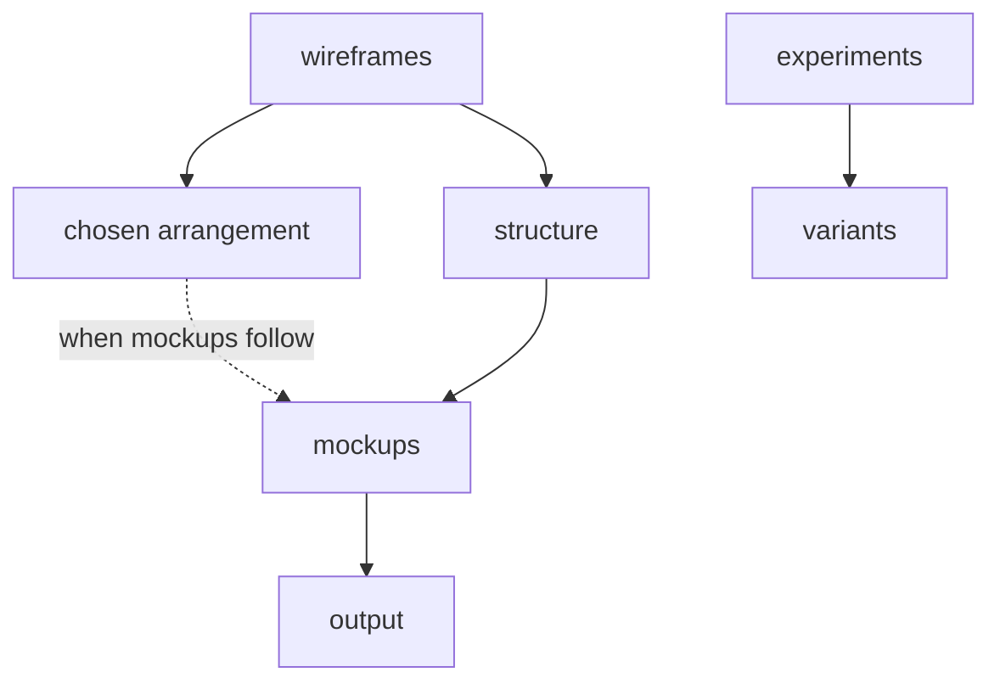

# Craft UI

Build wireframes, mockups, and in-app experiments in three phases over the brief and the other supplied inputs.

## Triggers

- **Wireframes** ("plan the layout", "map the screen flow", "arrange the screens", "compare arrangements", "settle the structure first") → [wireframes.md](references/wireframes.md) · the lo-fi arrangements, and the `structure.yaml` handoff when mockups follow
- **Mockups** ("generate directions", "compare looks", "preview a direction", "try an editorial direction", "adjust the chosen look") → [mockups.md](references/mockups.md) · the rendered directions, and the chosen mockup
- **Experiments** ("try this in the app", "compare variants in the running app", "test a new layout on the existing page", "try variants of this element in the app", "try an idea in the codebase") → [experiments.md](references/experiments.md) · variants compared in the running app

A request to try an idea against the UI a codebase already has routes to experiments; with no codebase, or no UI yet, it routes to wireframes and mockups.

## Workflow

Final copy comes after the mockup and is an input to no phase.
