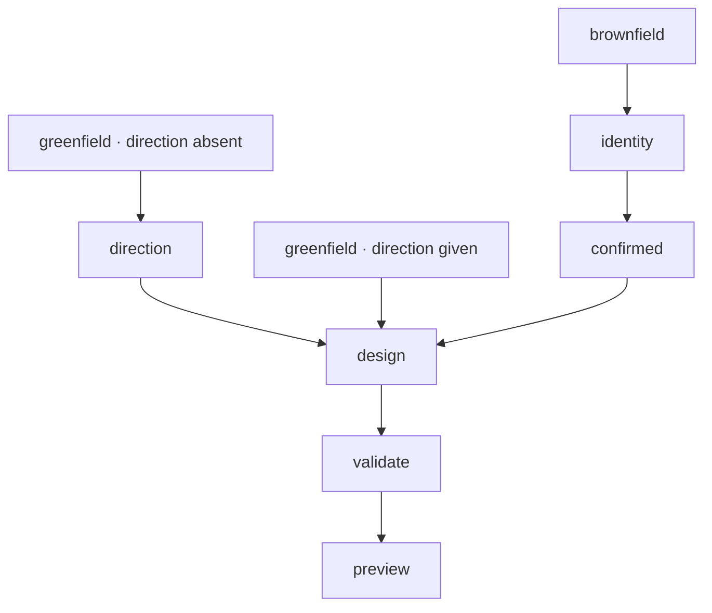

# DESIGN.md Builder

Develops and validates the visual identity carried by the root `DESIGN.md`.

## Triggers

- **Direction** — no visual reference yet, and the user wants to find a look ("explore", "find a look", "not sure how it should feel") → [direction.md](references/direction.md) · the exploration and the chosen direction
- **Identity assessment** — assess the current identity ("audit", "what is consistent or drifted") → [identity-assessment.md](references/identity-assessment.md) · findings on the existing `DESIGN.md`
- **Design** — author, create, extract, codify, refresh, rebrand, evolve, or sync → [design.md](references/design.md) · the written or updated `DESIGN.md`
- **Preview** — preview, tune, comment, or inspect visually → [preview.md](references/preview.md) · the rendered preview and the tuning loop
- **Validate** — validate, lint, or check `DESIGN.md` → [validate.md](references/validate.md) · the lint result and the fixes it names
- **Export** — export tokens → [export.md](references/export.md) · the tokens in the target format
- **Diff** — compare versions or check token regressions → [diff.md](references/diff.md) · the token diff

Load one operation at a time. Preview, validate, export, and diff enter directly; brownfield authoring passes through the identity assessment first.

## Workflow

Every operation starts by loading discovery. A brownfield assessment may end after presenting its findings when the user asked for an audit only.
