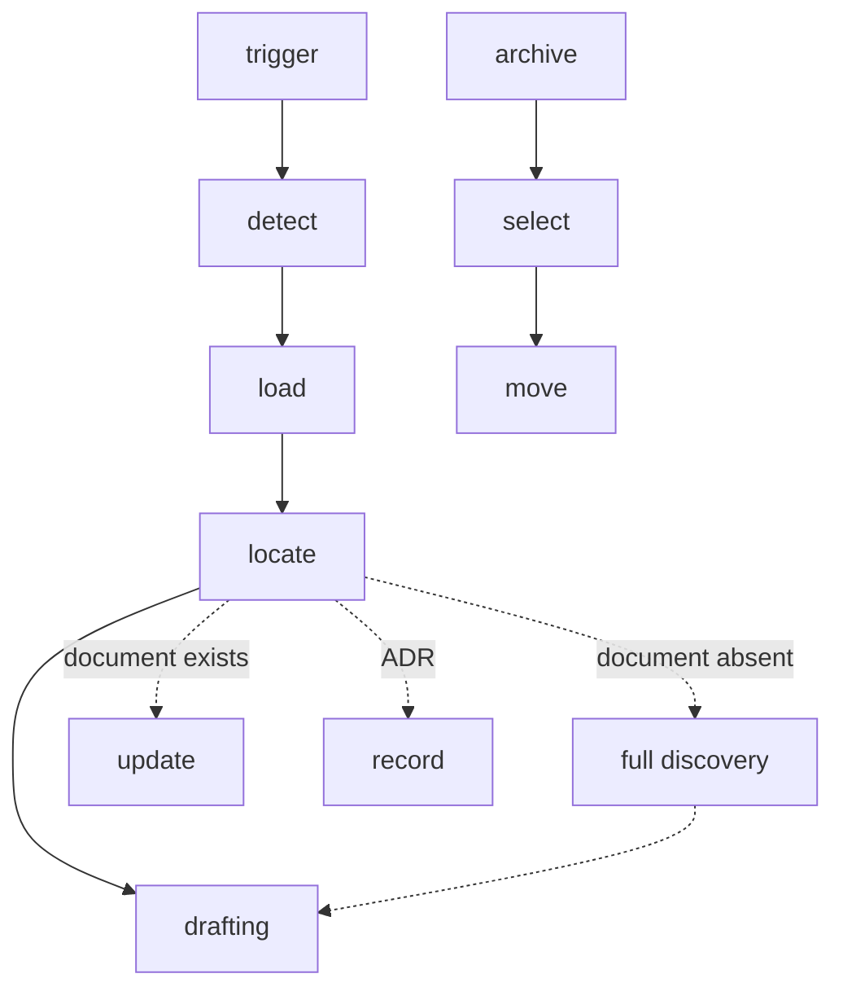

# Docs Writer

Write the product and technical documents a project carries, from requirements to decisions.

## Triggers

- **PRD** — product requirements for a new or changing product → [prd.md](references/prd.md)
- **Feature PRD** — requirements for one feature → [feature-prd.md](references/feature-prd.md)
- **Feature Design Doc** — the technical design of one feature → [feature-design.md](references/feature-design.md)
- **PRODUCT** — strategic positioning and identity → [product.md](references/product.md)
- **Design Doc** — lean technical design and trade-offs for the project → [design.md](references/design.md)
- **ADR** — a single architecture decision record → [adr.md](references/adr.md)
- **Archive feature** — move feature folders to cold storage → [feature-archive.md](references/feature-archive.md)

Detect the document type from the trigger. If ambiguous, ask the user.

For a feature request that asks for both documents, load `feature-prd.md` first and then `feature-design.md`.

## Workflow

