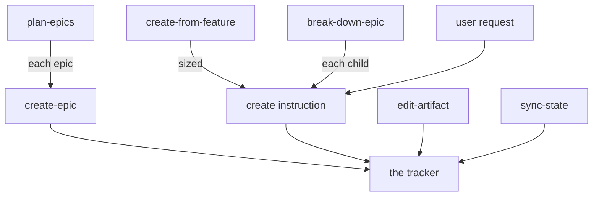

# Epic Tracker

Manage the delivery lifecycle in Linear or GitHub: plan epics, track tasks and spikes, and report bugs.

## Triggers

- **Feature source** — a feature design doc or PRD should become issues ("create from this feature design doc", "track this feature") → [create-from-feature.md](references/create-from-feature.md) · the issues sized from the feature
- **Plan epics** — turn a PRD into a roadmap ("create roadmap", "decompose the PRD", "create the epics from the roadmap") → [plan-epics.md](references/plan-epics.md) · the roadmap and its epics
- **Break down an epic** — one epic should become child issues ("break this epic into tasks", "decompose this epic") → [break-down-epic.md](references/break-down-epic.md) · the epic's children
- **Create epic** — one new epic ("create epic", "new epic") → [create-epic.md](references/create-epic.md) · the epic issue
- **Create task** — one new task ("create task", "add task", "create story") → [create-task.md](references/create-task.md) · the task issue
- **Create spike** — one new spike ("create spike", "add spike") → [create-spike.md](references/create-spike.md) · the spike issue
- **Report bug** — one new bug ("report bug", "bug report") → [report-bug.md](references/report-bug.md) · the bug issue
- **Edit** — an existing artifact's body should change ("edit task", "update spike", "edit bug") → [edit-artifact.md](references/edit-artifact.md) · the corrected body
- **Status, reparent, or dependencies** — move, close, or link existing issues ("mark done", "what's in progress", "reparent this task", "block this on X") → [sync-state.md](references/sync-state.md) · the moved, closed, or linked issue

## Workflow

