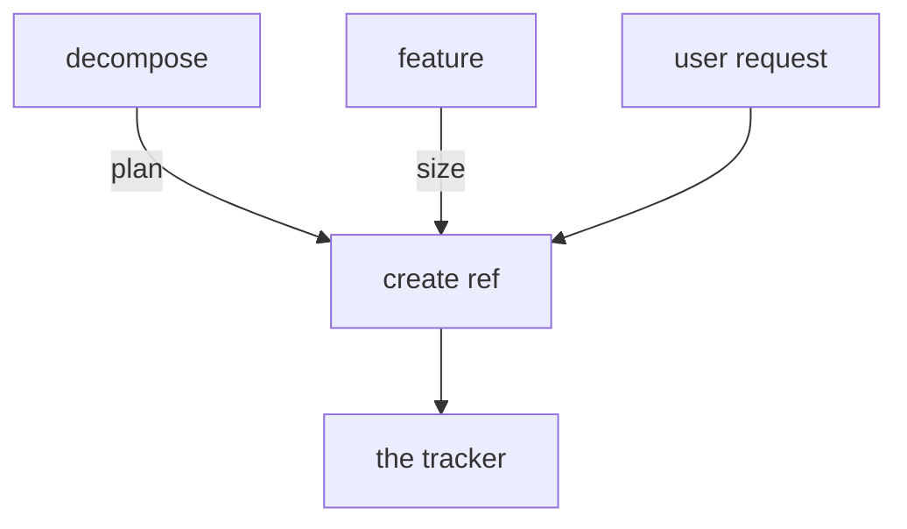

# Epic Tracker

Manages the delivery lifecycle in an external tracker. Plan epics, track tasks and spikes, and report bugs — every artifact lives in Linear or GitHub, which is the single source of truth.

## Triggers

- **Feature source** ("create from this feature design doc", "create from this feature PRD", "turn this feature design doc into issues", "track this feature") → [feature.md](instructions/feature.md)
- **Plan / decompose** ("create roadmap", "plan the roadmap", "organize epics", "roadmap the PRD", "decompose", "break down the roadmap", "break this epic into tasks", "create the epics from the roadmap") → [decompose.md](instructions/decompose.md)
- **Epic** ("create epic", "new epic", "edit epic") → [epic.md](instructions/epic.md)
- **Task** ("create task", "new task", "add task", "edit task", "update task", "change task", "create story", "create chore") → [task.md](instructions/task.md)
- **Spike** ("create spike", "new spike", "add spike", "edit spike", "update spike", "change spike") → [spike.md](instructions/spike.md)
- **Bug** ("create bug", "report bug", "bug report", "edit bug") → [bug.md](instructions/bug.md)
- **Status / overview** ("mark done", "cancel this", "won't fix", "list epics", "what's in progress", "update status") → [sync.md](instructions/sync.md)
- **Reparent** ("move this to epic X", "reparent this task", "change the parent epic") → [sync.md](instructions/sync.md)
- **Dependencies** ("block this on X", "unblock this", "this depends on X") → [sync.md](instructions/sync.md)

## Workflow

Every artifact takes the same path: a create ref drafts it and dispatches it to the tracker. `decompose` derives the plan from the project PRD, shows it as a draft in the chat, and creates the epics after the user approves it. When the user asks for a roadmap file, it writes `docs/product/ROADMAP.md` after that approval; a user who asks for only the roadmap gets it with nothing created. `feature` sizes a feature PRD or feature design doc into an epic or a standalone task, shows it as a draft in the chat, creates it after the user approves it, and writes no roadmap. A user request goes straight to the create ref, with no derivation. A configured tracker is required for tracker operations; report missing access without configuring the integration.
