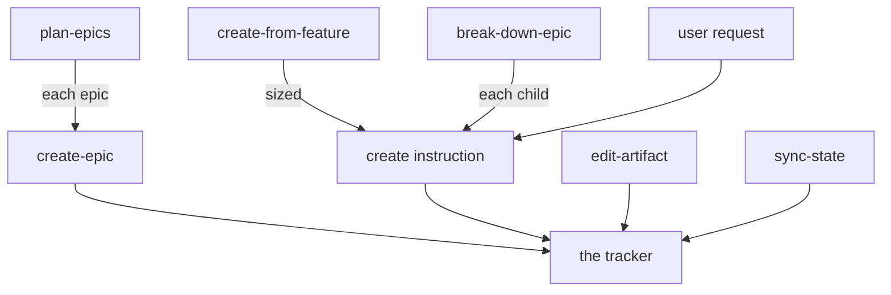

# Epic Tracker

Manages the delivery lifecycle in Linear or GitHub: plans epics, tracks tasks and spikes, and reports bugs.

## Triggers

- **Feature source** ("create from this feature design doc", "create from this feature PRD", "turn this feature design doc into issues", "track this feature") → [create-from-feature.md](instructions/create-from-feature.md)
- **Plan epics** ("create roadmap", "plan the roadmap", "organize epics", "roadmap the PRD", "decompose the PRD", "break down the roadmap", "create the epics from the roadmap") → [plan-epics.md](instructions/plan-epics.md)
- **Break down an epic** ("break this epic into tasks", "decompose this epic") → [break-down-epic.md](instructions/break-down-epic.md)
- **Create epic** ("create epic", "new epic") → [create-epic.md](instructions/create-epic.md)
- **Create task** ("create task", "new task", "add task", "create story", "create chore") → [create-task.md](instructions/create-task.md)
- **Create spike** ("create spike", "new spike", "add spike") → [create-spike.md](instructions/create-spike.md)
- **Report bug** ("create bug", "report bug", "bug report") → [report-bug.md](instructions/report-bug.md)
- **Edit** ("edit epic", "edit task", "update task", "change task", "edit spike", "update spike", "change spike", "edit bug") → [edit-artifact.md](instructions/edit-artifact.md)
- **Status / overview** ("mark done", "cancel this", "won't fix", "list epics", "what's in progress", "update status") → [sync-state.md](instructions/sync-state.md)
- **Reparent** ("move this to epic X", "reparent this task", "change the parent epic") → [sync-state.md](instructions/sync-state.md)
- **Dependencies** ("block this on X", "unblock this", "this depends on X") → [sync-state.md](instructions/sync-state.md)

## References

- [artifact-content.md](references/artifact-content.md) — loaded by every instruction that drafts or edits a body
- [tracker.md](references/tracker.md) — loaded by every instruction
- [ac-validation.md](references/ac-validation.md) — loaded by the create task, create spike, report bug, and edit artifact instructions
- [derivation.md](references/derivation.md) — loaded by the plan epics and create from feature instructions
- [ice-scoring.md](references/ice-scoring.md) — loaded by the plan epics and break down epic instructions
- [epic.md](assets/epic.md) — written by the create epic instruction, conformed by the edit artifact instruction
- [task.md](assets/task.md) — written by the create task instruction, conformed by the edit artifact instruction
- [spike.md](assets/spike.md) — written by the create spike instruction, conformed by the edit artifact instruction
- [bug.md](assets/bug.md) — written by the report bug instruction, conformed by the edit artifact instruction
- [roadmap.md](assets/roadmap.md) — written by the plan epics instruction, read by the create epic instruction

## Workflow

Every artifact reaches the tracker through its create instruction.
