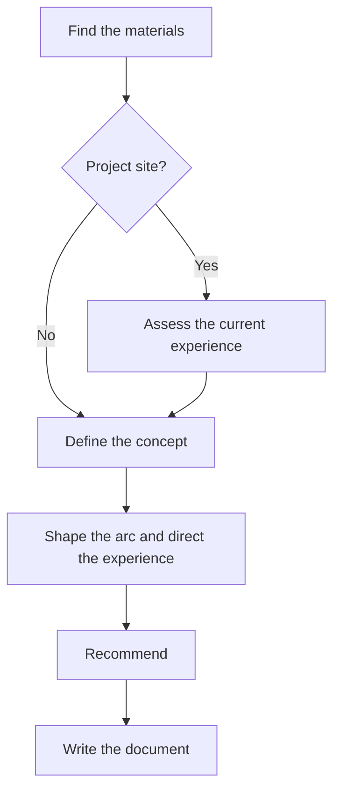

# Storytelling

Creates or revises the story and experience direction of a site: thesis, tension, arc, pacing, and the role of interaction and movement.

## What It Does



| Phase | Output |
| --- | --- |
| Find the materials | Materials matched by kind, the role of each site, the starting state |
| Assess the current experience | Observations from the code and the rendered pages |
| Define the concept | Thesis, tension, and feeling |
| Shape the arc | Ordered moments, grouped by page when the arc spans pages, with an entry line on a page a visitor can land on directly, each moment with its intent, its pace (peak or breather), and what leads to the next |
| Direct the experience | Role of interaction, the moments movement serves and its role at each, visual mood in words |
| Recommend | What to preserve, what to reinterpret, conflicts with the visual identity |
| Write the document | `storytelling.md` |

## Usage

```text
define the story for this site
this landing page feels generic, give it a central idea
what narrative should the home page tell
direct the experience of this site before we build it
revise the storytelling now that the pages are live
use this site as a reference for the story, not for the look
```

## Output

```text
docs/design/storytelling.md
```

A re-run revises the same file: untouched sections stay, and each recorded claim is re-checked against the new materials. The skill writes `draft`; the user sets `agreed`.

## Requirements

- A way to render the site (optional): the skill starts a local dev server for code in the repository, or opens a published address. When rendering fails, it asks how to proceed; on continuing without a render, it assesses from the code and records the limit.
- `agents/openai.yaml`: display metadata for hosts that show skills (`display_name` + `short_description`); never loaded by a step of the skill.

## FAQ

**Q: Does it need a brief or any other input?** A: No. It works from whatever exists (a work description, a visual identity, pages, code, reference sites) and asks for what is missing.

**Q: Does it change my code or visual identity?** A: No. Conflicts and changes appear as recommendations in the document.

**Q: Does it decide layout, visual values, timing, or assets?** A: It decides the order the moments arrive in and whether each is a peak or a breather — that pacing is the story's — but never how a moment becomes sections on the page. Visual identity values, timing, renderer, and assets belong to whoever builds.

**Q: Can it conclude that the site needs no motion or video?** A: Yes. The Movement entry records the decision and the reason, including a decision for none.
