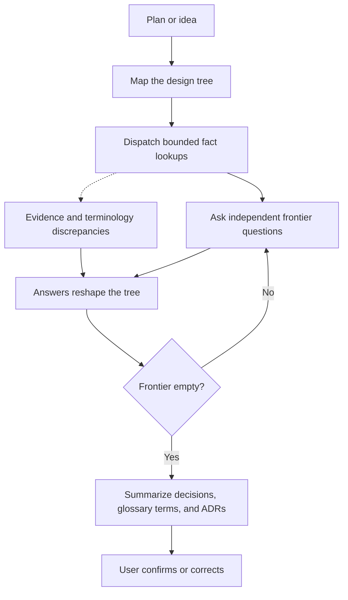

# Grill Me

Interview a plan, decision, or idea in rounds until every decision is settled.

## What It Does



| Phase | Output |
|-------|--------|
| Map and round | Questions: every decision whose prerequisites are settled, from the design tree the plan breaks into |
| Facts | Subagent findings scoped to a blocking fact, with source locations, terminology discrepancies, and unresolved facts; repository lookups include relevant glossary entries and code |
| Ask | Answers to independent questions while lookups run, collected through the harness question tool within its limits, or through a numbered list in chat without the tool |
| Close | Summary of the settled decisions, the terms that need a glossary entry, and the decisions that need an ADR, which the user confirms or corrects |

## Usage

```text
grill me on this plan
grill this architecture before we write the document
stress-test my idea for the export feature
ask me questions until we agree on the export feature
resolve the open decisions before the spec
```

## Output

The interview writes nothing to the repository. It keeps the decision tree in a JSON ledger in a temporary directory, and closes with a brief summary of the session: the settled decisions, the terms that need a glossary entry, and the decisions that need an ADR.

## Requirements

Uses the harness question tool when available and falls back to a numbered list in chat. Uses subagents for fact-finding when available and falls back to a bounded lookup in the main thread. A repository is optional. Python 3, standard library only, for the bundled ledger script.

## FAQ

**Q: How is this different from brainstorming?** A: Brainstorming generates and compares alternatives. Grilling takes a plan as given and settles each decision in it.

**Q: What if a question has no fixed options?** A: It is asked in chat, alone, instead of through the question tool.
