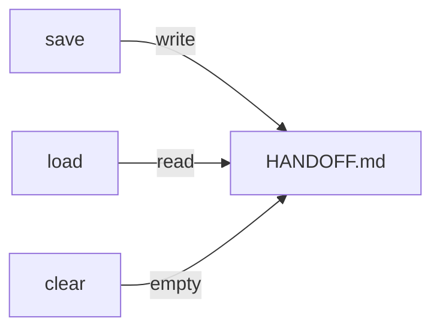

# Handoff

Capture conversation state in one consolidated `.artifacts/HANDOFF.md`, one block per topic, so a later session resumes with prior context.

## Triggers

- **Save** — checkpoint the session ("save context", "dump conversation", "checkpoint this", "session handoff") → [save.md](references/save.md) · the consolidated handoff file
- **Load** — resume from a previous session ("resume session", "load handoff", "continue from last") → [load.md](references/load.md) · the prior context read back
- **Clear** — reset the handoff ("clear handoff", "reset handoff") → [clear.md](references/clear.md) · the emptied handoff file

`/handoff load` → load. `/handoff clear` → clear. Any other argument, or none → save, with the argument as the topic.

## Workflow

