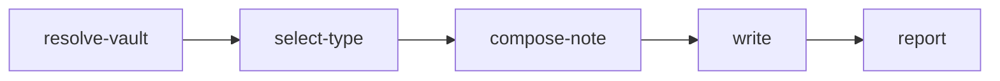

# Notes

Creates and manages structured Obsidian notes — project, challenge, brag, transcription, and company.

## Triggers

- **Project note** — document a project ("create project", "new project note") → [project.md](references/project.md) · the project note in the vault
- **Challenge note** — a technical challenge, take-home, or interview ("technical challenge", "coding interview", "system design") → [challenge.md](references/challenge.md) · the challenge note
- **Brag entry** — record an achievement ("brag document", "achievement", "accomplishment") → [brag.md](references/brag.md) · the brag entry
- **Transcription** — a meeting, lecture, or 1:1 ("transcription", "meeting notes", "lecture notes") → [transcription.md](references/transcription.md) · the transcribed note
- **Company tracking** — track an application ("company note", "track interview", "job application") → [company.md](references/company.md) · the company note

## Workflow

Each note type has its own workflow. Use any type independently.
