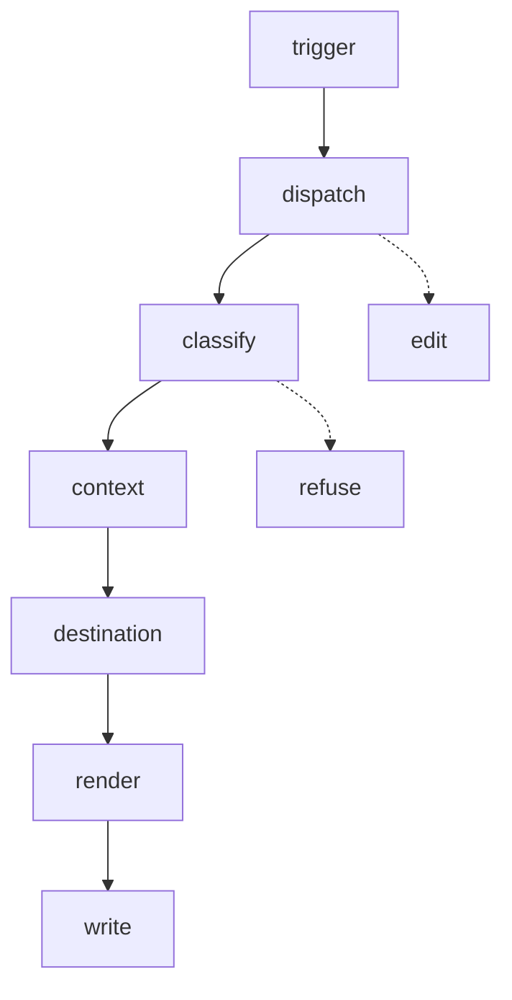

# Rule Creator

Creates rules at project or user level and manages the rule set at both.

## Triggers

- **Create** — a convention or standing preference should become a rule ("create rule", "add rule", "convention", or a declarative statement) → [create.md](references/create.md) · the new rule file
- **List** — see what rules exist ("list rules", "what rules exist") → [list.md](references/list.md) · the rules in scope
- **Edit** — change an existing rule ("edit rule X", "update rule X") → [edit.md](references/edit.md) · the updated rule
- **Extract** — split an oversized `AGENTS.md` or `CLAUDE.md` ("extract", "split", "AGENTS.md is too big") → [extract.md](references/extract.md) · the rules split out of the memory file
- **Delete** — remove a rule ("delete rule X", "remove rule X") → [delete.md](references/delete.md) · the removed rule

## Workflow

