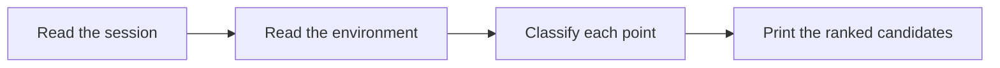

# Session Retro

Proposes changes to the agent's environment from what went wrong in a session.

## What It Does



| Phase | Output |
|-------|--------|
| Session | The points where the agent searched long, took a wrong turn, was corrected, or lacked information, each tied to a turn; the logs of the subagents the session started add their failed tool calls and repeated edits |
| Environment | What the `AGENTS.md` files say and which checks already run |
| Classification | A category and a cause for each point: automated check, standard, navigation, `AGENTS.md` size, no-op, tooling gap, tool economy, or information access |
| Candidates | A list in chat ranked by cost times recurrence, each with evidence, cause, the change, where it goes, and why that form |

## Usage

```text
run a retro on this session
what should we change in the setup so the agent does not make this mistake again
review this implementation session and propose environment improvements
```

## Output

The candidates are printed in chat only. Nothing is written to disk and no file changes.

## FAQ

**Q: Can it review an earlier session?** A: No. It reads the current conversation and the logs of the subagents that session started, so run it before clearing the session it looks back on.

**Q: Why prefer a check over a rule?** A: A linter rule, hook, or CI job fails the same way every time, while a written rule depends on the agent reading and following it.

**Q: Does it apply the changes?** A: No. The user picks which candidates to apply, in a separate step.
