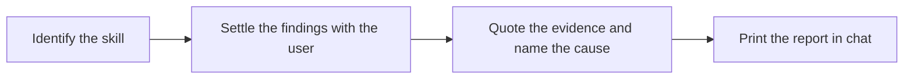

# Skill Feedback

Normalized improvement report about a skill, written from the session where it ran.

## What It Does



| Phase | Output |
|-------|--------|
| Identify | The skill's name, its loaded path, and the files the findings touch |
| Findings | The problems to report: the ones the user named, or deviations from the session the user confirmed |
| Evidence | For each finding, the quoted instruction, the session excerpt, the cause, and whether it was observed or inferred |
| Report | One markdown report in chat, ready to copy into the session that edits the skill |

## Usage

```text
write a skill feedback report for the step that skipped the tests
report this skill issue: it ignored the template
write feedback on the skill I just used
```

## Output

The report is printed in chat only. Nothing is written to disk and no skill file changes.

## FAQ

**Q: Why not apply the fix in the same session?** A: The session that hit the problem carries its bias toward that one case, and often runs in another repository; the report keeps the evidence so the editing session can judge the fix on its merits.

**Q: Why quote the instruction instead of a line number?** A: The installed copy of a skill can differ from its source, so quoted text still finds the line where a number would not.
