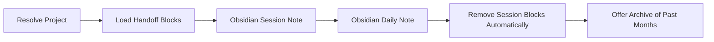

# Wrap Up

End-of-session documentation to Obsidian.

## What It Does



| Step | Output |
|------|--------|
| Resolve Project | Obsidian path and base tags, used internally |
| Load Handoff | Handoff blocks this session worked on, read from the filesystem, used internally |
| Obsidian Session | Session note in Obsidian with the work details |
| Obsidian Daily | Daily note in Obsidian with the day summary |
| Cleanup | This session's blocks removed from the handoff file, automatically; the file is emptied when no block remains |
| Archive offer | Past-month daily notes moved into `Daily/YYYY-MM/` in Obsidian, on yes |

## Usage

```text
/wrap-up
```

The skill runs only from the slash command; the model never starts it on its own.

## Output

- Obsidian session notes under `{obsidian.path}/Sessions/`
- Obsidian daily note at `Daily/YYYY-MM-DD.md`; past months are archived into `Daily/YYYY-MM/` when you accept the offer at the end of a run

## Requirements

| Dependency | Status | Without it |
|------------|--------|------------|
| Obsidian CLI (`obsidian`) | default | Obsidian MCP server when the CLI binary is missing or you decline to open the app, then a plain file write into the vault |

- Python 3, standard library only, for the bundled scripts
- An Obsidian vault. On first run in a repo the skill creates the registry at `~/.config/wrap-up/projects.yml` when absent and asks for the project entry.

## FAQ

**Q: What happens if Obsidian is closed?** A: The skill asks whether to open it. On no, it writes both notes through the Obsidian MCP server.

**Q: Does it ask before removing the session's handoff blocks?** A: No. Cleanup removes the blocks this session worked on after every configured note write succeeds, and leaves the blocks of other topics in the file. If persistence fails, the handoff remains available for retry.

**Q: What happens to handoff blocks from other sessions?** A: They stay in the file untouched, and the report lists their headings. A block belongs to the session when its context and current state describe work the conversation did or continued.

**Q: Does it move old daily notes on its own?** A: No. When daily notes from an earlier month remain at the root of `Daily/`, the report lists them and asks once whether to move them into `Daily/YYYY-MM/`. Nothing moves without a yes.

**Q: Can I run wrap-up multiple times in a day?** A: Yes. The workflow finds existing notes and appends the new content instead of overwriting them. The daily note merges activities from each invocation.

**Q: What if the project is not in the registry yet?** A: A bootstrap prompt asks for project name, Obsidian path, and base tags. The new entry is appended to `~/.config/wrap-up/projects.yml`.

**Q: What if the repo moved or the project was renamed?** A: When the old root no longer exists, the skill offers to update that entry instead of adding a second one. If the Obsidian folder is not at the new path, it warns you to rename the folder in Obsidian's file explorer, waits, and checks again; it never moves the folder itself.

**Q: What if I renamed the project's Obsidian folder?** A: When the folder at `obsidian.path` no longer exists, the skill asks whether it was renamed and updates the entry with the new path.

**Q: What happens to older notes after a rename?** A: The skill updates base tags, `part_of` links, and prose that refers to the project by its previous name in the notes under the project folder. Commands, paths, identifiers, and quotations stay unchanged. Daily notes outside that folder are not changed.
